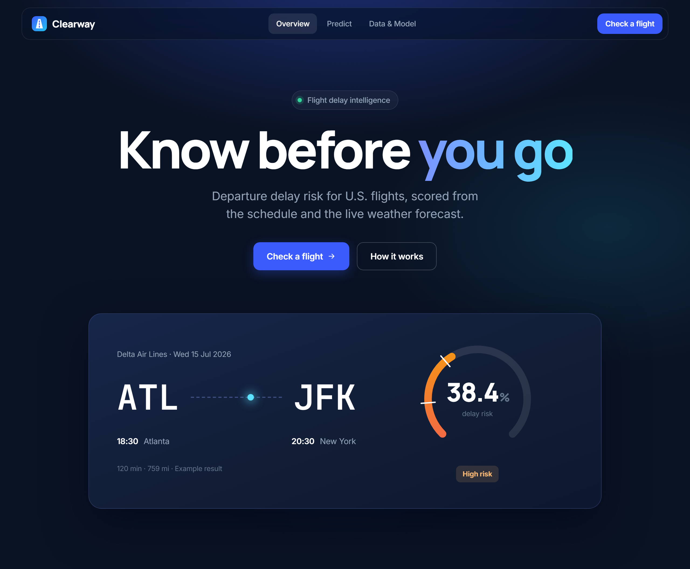
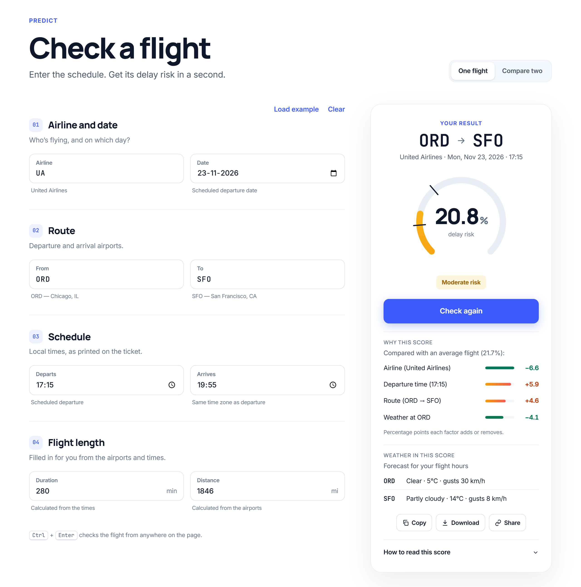
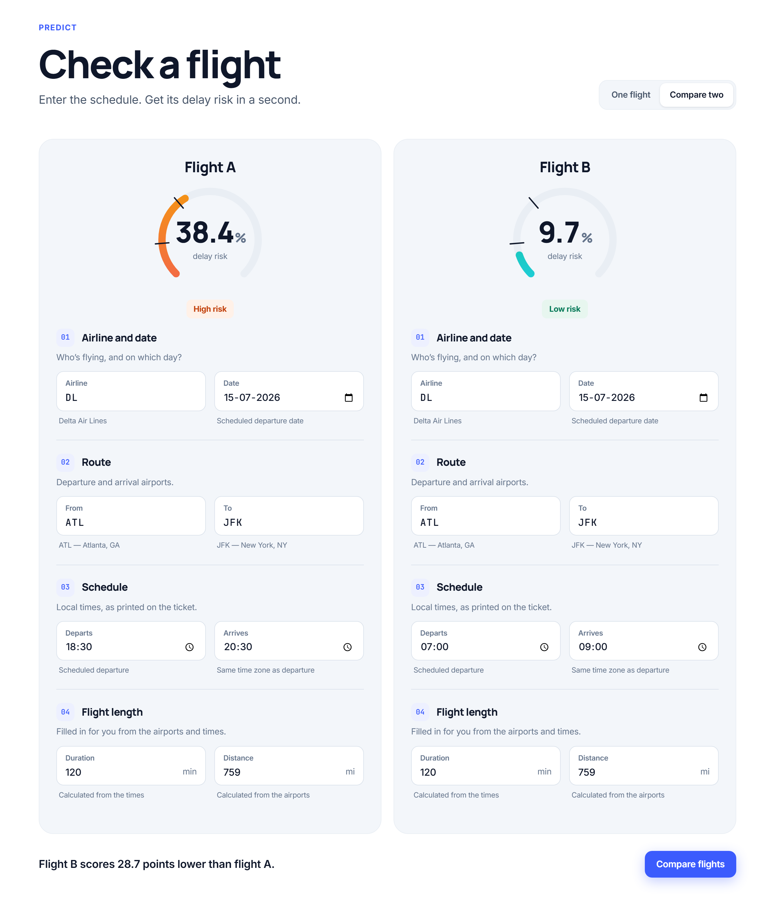
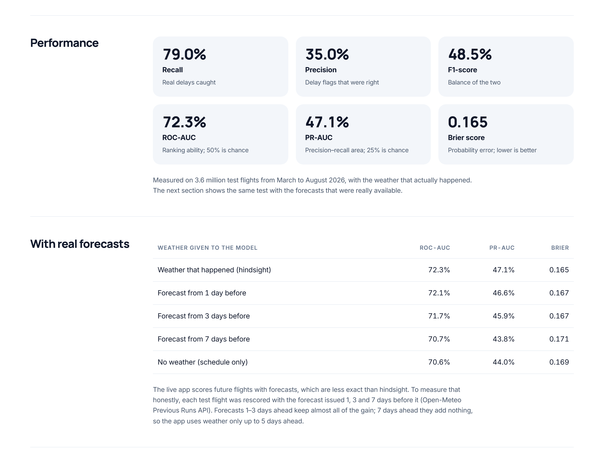
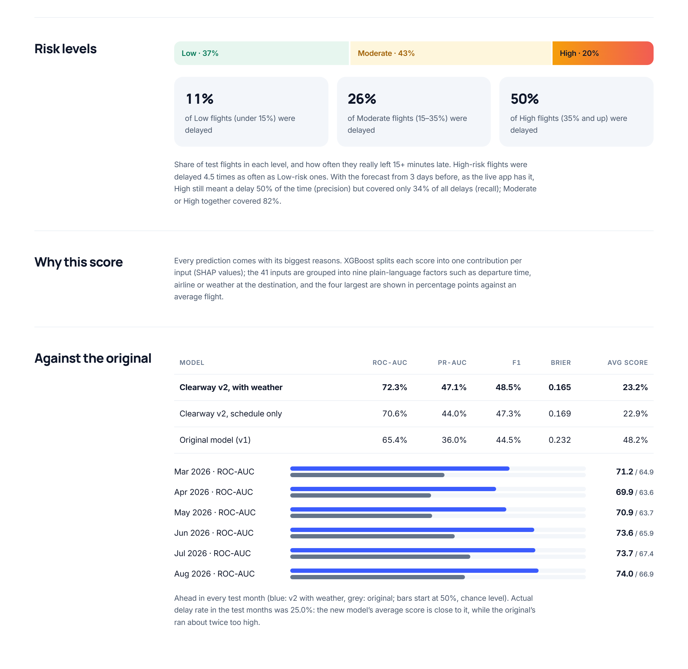
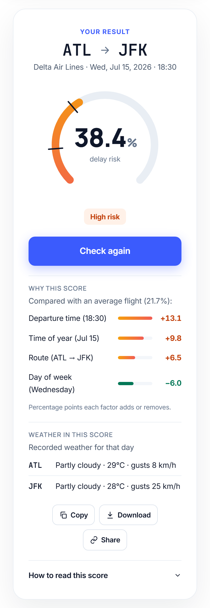

# Clearway — Flight Delay Risk Prediction

**Departure delay risk, before you fly.**

**Live demo: [clearway-mu-blue.vercel.app](https://clearway-mu-blue.vercel.app)**



A machine learning web application that scores the risk of a significant airline departure delay from the flight schedule and the live weather forecast, using an XGBoost model trained on 11.5 million U.S. flights, a Flask REST API, and a React frontend.

## Overview

The application predicts whether a U.S. domestic flight is likely to depart 15 minutes or more late. Users enter flight details in a web interface and receive a risk score, a Low, Moderate or High risk level, the biggest reasons behind the score, and the weather the model used.

The project demonstrates data preprocessing, feature engineering, classification, model evaluation, and full-stack application integration.

## Key Features

- Flight departure delay prediction
- Estimated delay probability with three risk levels
- "Why this score": the biggest factors for each flight, from the model's SHAP values
- Live weather forecast for both airports (Open-Meteo, used up to 5 days ahead)
- Interactive React interface
- Flask REST API for machine learning inference
- Flight input validation
- Automated feature engineering
- Model evaluation and comparison
- Flight comparison and exploratory data analysis interfaces

## Screenshots

**A prediction with its reasons.** The score, its risk level, the four factors that moved it most against an average flight, and the weather the model used.


**Live forecast.** For a flight in the next few days, the score uses the Open-Meteo forecast for the departure and arrival hours.



**Compare two flights.** The same route at 18:30 and 07:00: the morning flight scores 28.7 points lower.



**Data & Model page.** Test results, the test with real past forecasts, risk levels and the comparison with the original model.





**On a phone.**



## Machine Learning Workflow

1. Historical flight data preparation
2. Data cleaning and preprocessing
3. Feature engineering
4. Classification model training and comparison
5. Model evaluation and optimization
6. Final model selection
7. Integration of the trained model into Flask
8. Connection to the React frontend

## Features Used for Prediction

The v2 model uses 41 inputs, built by one shared function (`clearway_features.build_features`) for both training and the API, so a flight is turned into model inputs the same way in both places:

- **Flight:** airline, origin, destination and the route pair
- **Time:** departure and arrival hour, exact departure minute, day of week, weekend, month, day of month, days to the nearest U.S. federal holiday
- **Size:** scheduled duration and distance
- **Congestion:** average departures per hour at the origin and arrivals per hour at the destination, for that hour
- **Weather at each airport (11 each):** temperature, rain, snow, wind, gusts, cloud and conditions at the scheduled hour, plus the day's rain, snow and peak gust and the last three hours of rain
- **Network weather:** average rain, snow and peak gust across 20 major hubs that day, since delays ripple through the network

## Final Machine Learning Model (v2)

**Model:** XGBoost gradient-boosted trees (726 trees, trained on an NVIDIA GPU; any CPU runs it)

| Split | Period | Flights | Delayed |
|---|---|---:|---:|
| Train | Jan–Dec 2025 | 6,898,733 | 21.73% |
| Tune (early stopping, threshold) | Jan–Feb 2026 | 1,021,799 | 20.37% |
| Test (never used for any choice) | Mar–Aug 2026 | 3,602,999 | 25.02% |

Data: U.S. Bureau of Transportation Statistics on-time performance (11,730,351 raw records, 11,523,531 after removing cancelled or diverted flights, missing delays and duplicates), joined to hourly Open-Meteo weather for the 151 busiest airports (96% of flights). A significant delay means departing 15+ minutes late.

### Test Results (March–August 2026)

| Model | ROC-AUC | PR-AUC | Precision | Recall | F1 | Brier | Avg score |
|---|---:|---:|---:|---:|---:|---:|---:|
| **v2 with weather** | **72.3%** | **47.1%** | 35.0% | 79.0% | **48.5%** | **0.165** | 23.2% |
| v2 schedule only | 70.6% | 44.0% | 33.3% | 81.8% | 47.3% | 0.169 | 22.9% |
| Original model (v1) | 65.4% | 36.0% | 34.1% | 64.2% | 44.5% | 0.232 | 48.2% |

The actual delay rate in the test months was 25.0%. v2 beats v1 on ROC-AUC, PR-AUC, F1 and Brier score in each of the six test months, and its average score is close to the real rate, while v1's runs about twice too high. The decision threshold (17%) is the one with the best F1-score on the tuning months; it flags about 56% of flights to catch 79% of delays.

**Caveats.** Accuracy (58% for v2, 60% for v1) is not a useful measure here because delays are the minority class. Weather is hidden for 15% of training flights, so the model still works when no forecast is used.

### Tested With Real Forecasts

The table above uses the weather that actually happened. The live app only has forecasts, so `ml/fetch_forecasts.py` downloads the forecasts that were really issued 1, 3 and 7 days before each test flight (Open-Meteo Previous Runs API) and `ml/evaluate_forecasts.py` rescores the same 3.6 million flights with them:

| Weather given to the model | ROC-AUC | PR-AUC | Brier |
|---|---:|---:|---:|
| Weather that happened (hindsight) | 72.3% | 47.1% | 0.165 |
| Forecast from 1 day before | 72.1% | 46.6% | 0.167 |
| Forecast from 3 days before | 71.7% | 45.9% | 0.167 |
| Forecast from 7 days before | 70.7% | 43.8% | 0.171 |
| No weather (schedule only) | 70.6% | 44.0% | 0.169 |

Forecasts 1–3 days ahead keep almost all of the gain from weather; 7 days ahead they add nothing. The app therefore uses forecasts only up to 5 days ahead and scores later flights on the schedule alone. Every row beats the original model (65.4% ROC-AUC).

### Risk Levels

The score is shown in three levels, measured on the test months (recorded weather):

| Level | Score | Share of flights | Actually delayed |
|---|---|---:|---:|
| Low | under 15% | 37% | 11% |
| Moderate | 15–35% | 43% | 26% |
| High | 35% and up | 20% | 50% |

High-risk flights were delayed 4.5 times as often as Low-risk ones. The yes/no `prediction` field (17% cut-off) is kept in the API for the metrics above.

Each level works as a different trade-off between precision (how often a flag is a real delay) and recall (how many delays get flagged). Measured with the forecasts from 3 days before, as the live app has them:

| Flag when the level is | Flights flagged | Precision | Recall |
|---|---:|---:|---:|
| High | 17% | 50% | 34% |
| Moderate or High | 61% | 34% | 82% |

Adding humidity and CAPE (thunderstorm energy) was also tested. It helped with hindsight weather (PR-AUC 47.1% → 48.6%) but not with 3-day forecasts (45.9% → 45.8%), so it was left out.

### Why This Score

For every prediction, XGBoost splits the score into one contribution per input (SHAP values, `pred_contribs=True`). The API groups the 41 inputs into nine plain-language factors (departure time, day of week, time of year, airline, route, airport traffic, weather at each airport, weather at major hubs) and returns the four biggest, in percentage points: how far the score would move without that factor.

The original class-weighted scikit-learn Gradient Boosting model is kept as `final_gradient_boosting_model.pkl`. To use it instead, install `requirements-train.txt` (it needs scikit-learn) and start the backend with `CLEARWAY_MODEL=v1`.

## Technology Stack

**Machine Learning and Data Science**
- Python
- Pandas
- NumPy
- Scikit-learn
- XGBoost (GPU training)
- PyArrow (Parquet)
- Joblib
- Open-Meteo weather API (free, no key)

**Backend**
- Flask
- REST API

**Frontend**
- React
- JavaScript
- Vite
- CSS
- d3-geo and U.S. Census state shapes (us-atlas) for the route map

## System Architecture

```text
User
 |
 v
React Frontend
 |
 | POST /predict
 v
Flask REST API
 |
 v
Input Validation
 |
 v
Weather lookup (Open-Meteo: forecast, or recorded for past dates)
 |
 v
Feature Engineering (shared with training)
 |
 v
XGBoost model (v2)
 |
 v
Prediction and Delay Probability
 |
 v
React Results Interface
```

## Getting Started

### Prerequisites

- Python and pip
- Node.js and npm

### 1. Set Up the Backend

Open a terminal in the project root directory.

Create a virtual environment:

```powershell
python -m venv .venv
```

Activate it:

```powershell
.\.venv\Scripts\Activate.ps1
```

Install the dependencies:

```powershell
python -m pip install -r requirements.txt
```

`requirements.txt` is what the app needs to run (the CPU build of XGBoost). For training, install `requirements-train.txt` instead; it is a complete list, so don't install both.

Start the Flask backend:

```powershell
python app.py
```

The backend normally runs at `http://127.0.0.1:5001` (`/api/health` confirms it is up). It loads `models/v2_model.ubj.gz` and `models/v2_meta.json`; set `CLEARWAY_MODEL=v1` to use the original model, or `FLASK_DEBUG=1` for Flask's debug mode during development. Weather lookups need an internet connection; without one, predictions fall back to the schedule alone.

Keep this terminal open.

### 2. Set Up the Frontend

Open a second terminal:

```powershell
cd frontend
npm ci
npm run dev
```

Open the local URL printed by Vite, usually `http://localhost:5173`.

The Vite development proxy forwards `/predict` requests to the Flask backend.

Keep both servers running while using the application.

### 3. Retrain the Model (optional)

Training needs about 4 GB of downloads and 16 GB of RAM; an NVIDIA GPU makes it take minutes. Install `requirements-train.txt` (in place of `requirements.txt`): it has the CUDA build of XGBoost, Parquet support and scikit-learn.

1. Download the BTS "Reporting Carrier On-Time Performance" monthly zips (January 2025 to August 2026) into `ml/data/raw/`, named `YYYY_M.zip`.
2. Build the flight table: `python ml/prepare.py`
3. Fetch hourly weather for the busiest airports (about an hour, because of the free API's rate limit): `python ml/fetch_weather.py`
4. Train and evaluate: `python ml/train.py`. This writes `models/v2_model.ubj.gz` (the trees, in XGBoost's own format), `models/v2_meta.json` (categories, traffic tables, threshold) and `models/v2_metrics.json`.
5. Optional, test with real past forecasts: `python ml/fetch_forecasts.py` (about 2 hours on a slow connection), then `python ml/evaluate_forecasts.py`, which writes `models/v2_forecast_eval.json`.

Run the Python tests with `python -m unittest test_features`.

### 4. Deploy to Vercel

The repository deploys as one Vercel project: the React site is served from Vercel's CDN and `app.py` runs as a Python function on the same domain, so `/predict` needs no extra setup. No API keys are needed.

1. Push the repository to GitHub, with `models/` included (about 10 MB).
2. In Vercel, choose **Add New → Project**, import the repository, and choose **Import single project** for the Flask app at `/` (not the multi-service option). `vercel.json` keeps the training code and data out of the Python function.
3. Deploy. Every push to the main branch redeploys; other branches get preview links.

The website is committed prebuilt in `public/`, because Vercel's Flask setup serves `public/` as it is in the repository and ignores files a build step creates there. After changing the frontend, run `npm run build:site` in `frontend/` and commit `public/` with the change.

Check the deployment at `https://<your-project>.vercel.app/api/health`. The free Hobby plan is for personal, non-commercial use.

## API Reference

### Predict Flight Delay

**Endpoint:** `POST /predict`

**Content-Type:** `application/json`

Example request:

```json
{
  "carrier": "DL",
  "origin": "ATL",
  "destination": "JFK",
  "flight_date": "2026-07-15",
  "departure_time": "18:30",
  "arrival_time": "20:30",
  "elapsed_time": 120,
  "distance": 760
}
```

Example response structure:

```json
{
  "prediction": "Significant Delay",
  "delay_probability": 38.38,
  "threshold": 17.0,
  "risk_level": "high",
  "model_version": "v2",
  "weather": {
    "source": "historical",
    "origin": {"temp": 29.3, "precip": 0.0, "snow": 0.0, "wind": 1.8, "gust": 7.6, "cloud": 48.0, "code": 1.0},
    "destination": {"temp": 28.3, "precip": 0.0, "snow": 0.0, "wind": 7.8, "gust": 25.2, "cloud": 20.0, "code": 1.0}
  },
  "reasons": {
    "baseline": 21.7,
    "factors": [
      {"factor": "time", "effect": 13.1},
      {"factor": "season", "effect": 9.8},
      {"factor": "route", "effect": 6.5},
      {"factor": "day", "effect": -6.0}
    ]
  }
}
```

`risk_level` is `low`, `moderate` or `high`. `reasons.baseline` is the score of an average flight; each factor's `effect` is in percentage points. `weather.source` is `forecast` (up to 5 days ahead), `historical` (recorded weather for past dates) or `unavailable` (the score then uses the schedule alone). Temperatures are in °C, rain in mm, snow in cm, wind in km/h and `code` is the WMO weather code.

## Project Structure

```text
clearway/
├── app.py                      # Flask API: validation, weather lookup, inference
├── clearway_features.py        # feature engineering shared by training and the API
├── clearway_weather.py         # Open-Meteo forecast and history, shared too
├── test_features.py            # Python unit tests
├── final_gradient_boosting_model.pkl   # original model (v1), CLEARWAY_MODEL=v1
├── models/
│   ├── v2_model.ubj.gz         # current model (XGBoost format, gzipped)
│   ├── v2_meta.json            # its categories, traffic tables and threshold
│   ├── v2_metrics.json         # test results per month
│   └── airports.json           # airport coordinates for weather lookups
├── ml/
│   ├── prepare.py              # BTS zips -> cleaned flight table with splits
│   ├── fetch_weather.py        # hourly weather history per airport
│   ├── fetch_forecasts.py      # forecasts issued 1, 3 and 7 days ahead, for the test months
│   ├── evaluate_forecasts.py   # rescoring the test set with those real forecasts
│   └── train.py                # GPU training, threshold choice, evaluation vs v1
├── requirements.txt            # to run the app (CPU XGBoost)
├── requirements-train.txt      # to train (GPU XGBoost, Parquet, scikit-learn)
├── vercel.json                 # Vercel function settings
├── public/                     # built website served by Vercel (npm run build:site)
├── test_api.py
├── README.md
└── frontend/
    ├── package.json
    ├── vite.config.js          # proxies /predict to the Flask API
    └── src/
        ├── App.jsx             # shell: navigation, theme, toasts
        ├── index.css           # design tokens and base type
        ├── App.css             # component styles
        ├── pages/              # Overview, Predict, Data & Model
        ├── components/         # form, result panel, compare, route context
        ├── lib/flight.js       # request, auto-fill and risk helpers (+ tests)
        └── data/               # airline and airport reference data
```

Run the frontend unit tests with `npm test` inside `frontend/`.

## Limitations

- Predictions are estimates and cannot guarantee actual flight outcomes.
- Model performance depends on the training data and the information supplied.
- About 35% of delay flags turn out to be real delays: the threshold favours catching delays over avoiding false alarms. Even the High level is right only about half the time and covers about a third of delays.
- Weather only improves scores for flights in the next few days; beyond 5 days they are scored from the schedule alone.
- Air traffic control programmes, crew and aircraft problems are not modelled.
- On Vercel's free plan, the first prediction after a quiet spell takes a few seconds longer while the Python function starts.

## Data Sources

Flight data: U.S. Bureau of Transportation Statistics. Weather: [Open-Meteo](https://open-meteo.com/) (CC BY 4.0).

## License

MIT License; see [LICENSE](LICENSE).
